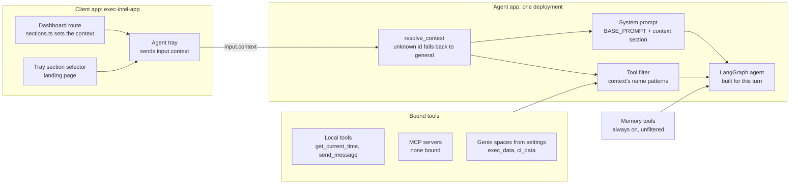
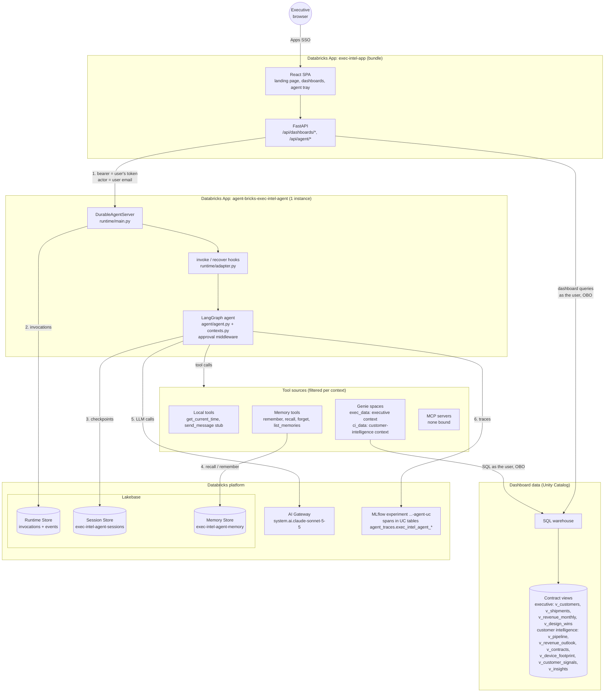
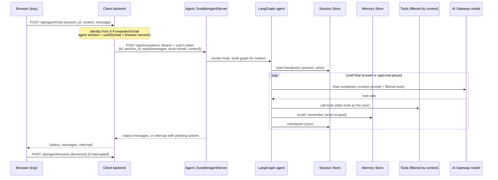
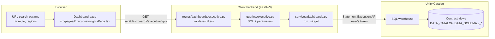
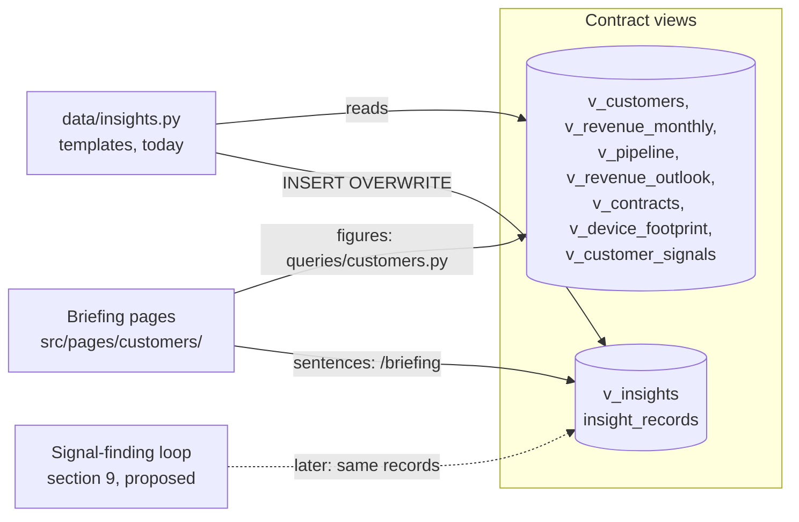
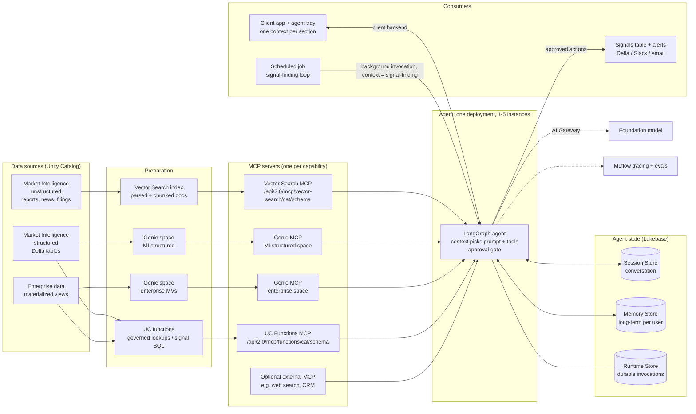
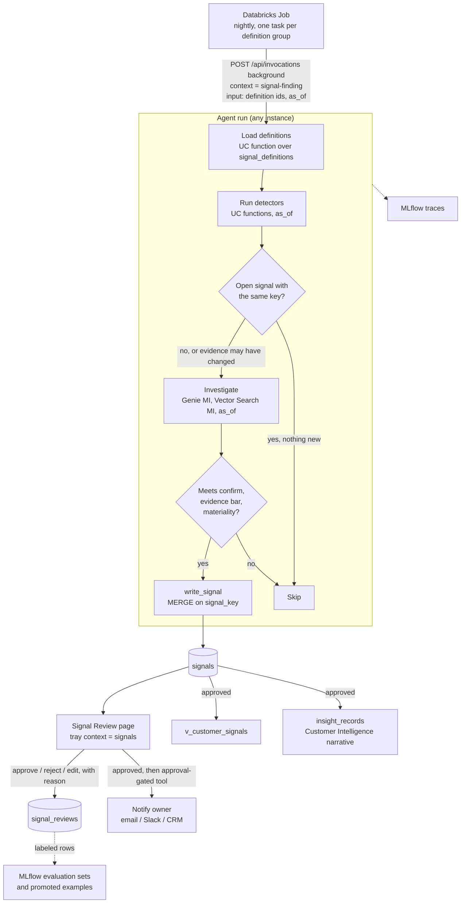

# Executive Intelligence architecture

Executive Intelligence consists of one agent and one client application, each deployed as a
Databricks App:

- **Client** (`exec-intel-app`): React and FastAPI. A landing page and dashboards, with an agent tray
  docked on the right of every page. Dashboards query Unity Catalog views as the signed-in user.
- **Agent** (`agent-bricks-exec-intel-agent`): a single LangGraph agent hosted by Agent Bricks.

Each section of the client is an **app context**. The client sends the current context with every
request, and the agent uses it to choose its prompt section and the tools offered for that turn.
Sections therefore share one agent deployment instead of each having its own. Each dashboard is one
section, registered once in the client (`src/sections.ts`), which gives it a route, a nav link, and
its agent context.

Contents:

- [1. Status](#1-status)
- [2. Repository layout and deployment](#2-repository-layout-and-deployment)
- [3. App contexts](#3-app-contexts)
- [4. Runtime architecture](#4-runtime-architecture)
- [5. Request lifecycle](#5-request-lifecycle)
- [6. Identity and security](#6-identity-and-security)
- [7. Dashboards and data access](#7-dashboards-and-data-access)
- [8. Target data architecture (proposed)](#8-target-data-architecture-proposed)
- [9. Signal-finding loop (proposed)](#9-signal-finding-loop-proposed)
- [10. Scaling](#10-scaling)
- [11. When to split into separate agents](#11-when-to-split-into-separate-agents)
- [12. Terminology changes from the original sketch](#12-terminology-changes-from-the-original-sketch)

---

## 1. Status

As of 2026-11-11, in the development workspace. "Verified" means exercised against the deployed apps
unless noted otherwise.

| Component | Status |
| --- | --- |
| Client app | Deployed. The landing page has one tile per dashboard and a button that opens the tray. Branding (name, logo, colors) is build-time config with a neutral default; see "Branding" in the app README. The header shows a "Synthetic data" badge while the bundle variable `synthetic_data` is `"true"`. |
| Dashboards | Two. Executive Insights, the reference for the dashboard framework (section 7): three KPIs, two charts, a top-customers table, period and region filters; deployed and verified 2026-11-11. Customer Intelligence, a briefing for sales and finance leadership on the top 10 accounts, with a page per account (section 7). |
| Dashboard data | Ten contract views in `<catalog>.exec_intel` over synthetic tables generated by `data/load.py`: 60 invented customers with three years of shipments, revenue, and design wins, plus pipeline, plan and forecast, contracts, device footprint, and market signals for Customer Intelligence. No real data; `data/contract.md` lists everything that is invented. |
| App state | The Settings overrides (`agent_context_settings`), in the client's own Lakebase Autoscaling project, which scales to zero. Locally, a bundled Postgres in `.pgdata`. Verified locally 2026-11-12; the project has not been deployed. Everything else the app reads is business data and stays in Unity Catalog, read as the user: the contract views, and the insight records, which Genie reads and a SQL job writes. The agent's memory and sessions are its own managed stores; traces are UC tables through MLflow. The release-notes marker and tray width are in the browser's localStorage. |
| Briefing narrative | Insight records (`v_insights`) written by `data/insights.py` from fixed templates over the views. A stand-in for the signal-finding loop (section 9): no model and no human review. |
| User authorization (OBO) | The client requests the `sql`, `apps`, and `genie` scopes. Verified 2026-11-11 19:26 UTC: the deployed dashboard's five queries appear in the warehouse's query history under the signed-in user, not the app's service principal. |
| Client to agent authentication | The signed-in user's token, forwarded by the client. Verified 2026-11-11 23:20 UTC from the deployed tray: a Customer Intelligence question's Genie queries appear in query history under the signed-in user. |
| Agent app | Deployed and answering (verified 2026-11-11 15:44 UTC). Requires the workspace's **Agent Memory Sessions** preview (Previews page, workspace admin), which gates the managed Memory and Session Store APIs but not the Runtime Store ([Agent sessions docs](https://docs.databricks.com/aws/en/agents/agent-memory/managed-sessions)). Databricks began enforcing that gate on 2026-11-10 between 17:50 and 19:47 UTC; this workspace had never turned the preview on, so every request failed with `FEATURE_DISABLED` until it was enabled on 2026-11-11. The agent now fails open (`agent/stores.py`): it checks each configured store with one read before building a turn, and where a store cannot answer it uses an in-process checkpointer and offers no memory tools, tells the model so, and checks again after a minute. That is covered by offline tests only; it has not been run against a workspace without the preview. Whether `agentbricks deploy` can create the stores without the preview is not verified. |
| App contexts | Implemented: `general`, `executive`, `customer-intelligence`, `market-intelligence`, `signals`. Per-context tool filtering verified 2026-11-10. On a dashboard the route sets the context; on the landing page the tray has a section selector. `market-intelligence` and `signals` have no pages yet. |
| Model | `system.ai.claude-sonnet-5-5` through the AI Gateway. Verified. |
| Local tools | `get_current_time` works. `send_message` is a stub: it returns a confirmation string and sends nothing. |
| Data tools | Two Genie spaces, created by `data/genie.py` and bound to their contexts by the `genie_bindings` bundle variable; admins can change them on the Settings page without a deploy. Queries run as the signed-in user. "Executive Insights data" over the first four contract views, bound as `exec_data` (tools `exec_data_ask`, `exec_data_poll`, `exec_data_query_result`) to the `executive` context; verified from the deployed tray 2026-11-11: "Which customers are at risk, and why?" answered with figures from the space. "Customer Intelligence data" over the Customer Intelligence views, bound as `ci_data` to the `customer-intelligence` context; verified from the local tray 2026-11-12, not yet deployed. No MCP servers, UC functions, or Vector Search indexes are bound; the `market_*`, `mi_*`, and `signal_*` patterns match no tools, so nothing retrieves the market-intelligence documents themselves. |
| Approval gate | Implemented on `send_message`, which only the `general` and `market-intelligence` contexts offer. Interrupt and reject verified against a local agent 2026-11-10; interrupt and approve verified against the deployed agent through the client backend's `/api/agent/chat` and `/api/agent/resume` 2026-11-11. |
| Session Store | Provisioned (`exec-intel-agent-sessions`). Working since the preview was enabled on 2026-11-11. |
| Memory Store | Provisioned (`exec-intel-agent-memory`). Remember and recall across conversations verified from the deployed tray 2026-11-11. |
| Runtime Store | Provisioned by `agentbricks deploy`. Crash recovery not tested. |
| Tracing | Until 2026-11-11, traces in `/Shared/agentbricks_traces/executive-intelligence-agent` were saved without spans: MLflow uploads spans through the regional storage proxy (`us-west-2.storage.cloud.databricks.com`), which Databricks Apps in some workspaces cannot reach. The agent now uses `/Shared/agentbricks_traces/executive-intelligence-agent-uc`, linked by `scripts/trace_storage.py` to Unity Catalog tables `<catalog>.agent_traces.exec_intel_agent_*`, which MLflow writes through the workspace API; `agentbricks deploy` binds those tables to the agent app with MODIFY. Verified 2026-11-11: a tray question's trace has all 17 spans, including the Genie tool calls. |
| Instances | One. Multiple instances not tested. |
| Workspace portability | `scripts/preflight.sh` checks a workspace; the README's "Moving to another workspace" lists the steps. Only the development workspace has been checked. |
| Sections 8 and 9 | Not built. |

---

## 2. Repository layout and deployment

```text
databricks.yml                  Bundle for the client app only
dev.sh                          Runs the agent and the client locally, connected
deploy.sh                       Runs preflight, deploys both apps, and connects them
scripts/preflight.sh            Read-only check that a workspace has what the apps need
README.md                       Deploying, and moving to another workspace
architecture.md                 This file (diagram PNGs in docs/)
data/                           Dashboard data contract, synthetic data, grants (section 7)
executive-intelligence-agent/   The agent (Agent Bricks, LangGraph)
  agent.toml                    Deploy name, Memory and Session Stores, tracing
  agent/contexts.py             App contexts: prompt section and tool patterns
  agent/agent.py                Graph built per turn from the request's context
  runtime/adapter.py            Reads input.context and input.actor from each request
executive-intelligence-app/     The client (seeded from app-template)
  server/routes/agent.py        /api/agent/chat and /api/agent/resume
  server/services/agent.py      Calls the agent app; session hashing; output shaping
  server/routes/dashboards/     Widget endpoints, one module per dashboard
  server/queries/               Widget SQL over the contract views, one module per dashboard
  server/services/dashboards.py Widget execution as the user, filters, error mapping
  src/sections.ts               Dashboard registry: route, nav, landing tile, agent context
  src/components/dashboard/     Dashboard toolkit (page shell, KPI, chart, table, filters)
  src/components/story/         Briefing toolkit (chapters, so-whats, recommendations, figures)
  src/pages/                    Landing page, one page (or folder) per dashboard, 404
  src/components/AgentTray.tsx  The tray
  src/agentContexts.ts          Context ids the client sends (must match the agent)
```

```bash
./deploy.sh -p <profile> --var data_catalog=<catalog>               # everything
./deploy.sh -p <profile> --var data_catalog=<catalog> --app-only    # client only
./deploy.sh -p <profile> --agent-only                               # agent only
```

The two apps are deployed with different tools:

| Part | Tool | Reason |
| --- | --- | --- |
| Agent | `agentbricks deploy` | Provisions the Memory, Session, and Runtime Stores in Lakebase, creates the tracing experiment, grants the app access to them, and writes the app's environment. Bundles have no resource type for these, and the Agent Bricks CLI does not read `databricks.yml`. |
| Client | `databricks bundle deploy` from the root `databricks.yml` | A standard Databricks App. The bundle syncs only `executive-intelligence-app/`, including its built `dist/`, and creates the app's Lakebase Autoscaling project (`<app_name>-v1`, 0.5 to 1 CU, suspended after 5 idle minutes, `prevent_destroy`) for app state such as Settings. |

`deploy.sh` runs `scripts/preflight.sh`, starts the agent deploy, builds the frontend while the
agent's compute starts, waits for the agent to answer, and looks up the agent's URL. It then deploys
the bundle with that URL and any `--var` values, gives everyone with CAN USE on the client CAN USE
on the agent app, and starts the client. Everything workspace-specific is a bundle variable
(`data_catalog`, `data_schema`, `warehouse_id`, `app_name`, `genie_bindings`), so another workspace needs different
variables, not different code.

The agent's deploy name is `exec-intel-agent` because Agent Bricks limits it to 17 characters (the
app name becomes `agent-bricks-<name>`, limited to 30).

---

## 3. App contexts

The agent builds its LangGraph graph on every turn (`create_agent_graph` runs per invocation), so the
prompt and tool list can differ between requests without a redeploy.



A context is an `AppContext` in `executive-intelligence-agent/agent/contexts.py`:

| Field | Purpose |
| --- | --- |
| `id` | Value of `input.context`: `general`, `executive`, `customer-intelligence`, `market-intelligence`, or `signals` |
| `prompt` | Instructions appended to `BASE_PROMPT` |
| `tools` | fnmatch patterns over tool names; `("*",)` offers every tool |

These are defaults. An admin can override any context's prompt, its built-in tools, and its Genie
spaces on the client's Settings page (account menu > Settings, shown to members of `ADMIN_GROUP`).
A context's default Genie spaces come from the `genie_bindings` bundle variable
(`context:tool_name:space_id` entries, which `data/genie.py` prints). Overrides live in the
`agent_context_settings` table in the client's own Lakebase database, one row per context; a
context with no row, or a row whose Genie list is null, uses the bundle's bindings, and resetting a
context deletes its row. The app reads and writes the table as its service principal, so the
`ADMIN_GROUP` check is the only gate on writes (section 6). The client reads the row on each turn
and sends the result as `input.settings`; the agent builds that turn's Genie tools from it and
appends a generated "Data tools" paragraph to the prompt. A space named `ci_data` becomes
`ci_data_ask`, `ci_data_poll`, and `ci_data_query_result`. Taking settings from the caller is safe
because every data tool runs as the caller: someone who calls the agent directly with their own
settings reaches nothing they could not query anyway. The Genie rows in the table below are the
bundle's bindings.

| Context | Tools offered today |
| --- | --- |
| `general` | All bound tools |
| `executive` | `get_current_time`, `exec_data_ask`, `exec_data_poll`, `exec_data_query_result` |
| `customer-intelligence` | `get_current_time`, `ci_data_ask`, `ci_data_poll`, `ci_data_query_result` |
| `market-intelligence` | `get_current_time`, `send_message` (the `market_*` and `mi_*` patterns match nothing yet) |
| `signals` | `get_current_time` (the `signal_*` pattern matches nothing yet) |

Memory tools (`remember`, `recall`, `forget`, `list_memories`) are added after filtering, so they are
available in every context and memory is shared across sections. Session state is keyed by session,
not context. The system prompt is supplied at each model call rather than stored in the checkpoint,
so a context change takes effect on the next turn. The tray keeps a separate conversation per
context.

To add a section: add an `AppContext` in `agent/contexts.py`, add the id to `src/agentContexts.ts`,
redeploy both apps, and bind its Genie spaces on the Settings page. The agent
treats an unknown id as `general`, so the client can be deployed first.

Prompt sections can later move from code to the MLflow Prompt Registry
(`agentbricks experimental prompts`) so they can be edited and evaluated without a code change.

---

## 4. Runtime architecture



| Component | Location | Responsibility |
| --- | --- | --- |
| Landing page | `src/pages/LandingPage.tsx` | One tile per `sections.ts` entry, and a button that opens the tray in the general context |
| Dashboards | `src/sections.ts`, `src/pages/`, `server/routes/dashboards/` | Widgets queried as the signed-in user (section 7) |
| Insight records | `data/insights.py`, `data/views/insights.sql` | Customer Intelligence's narrative, written from templates when `data/load.py` runs |
| Agent tray | `src/components/AgentTray.tsx` | One conversation per context, tool-use details, Approve / Reject card for paused actions |
| Agent proxy | `server/routes/agent.py`, `server/services/agent.py` | Takes identity from the Apps proxy headers, derives the agent session id, calls `/api/invocations`, reduces the output to messages and pending actions |
| `DurableAgentServer` | `runtime/main.py` | Foreground, streaming, and background invocations; polling and replay |
| Adapter | `runtime/adapter.py` | Reads `input.messages`, `input.actor`, `input.context`, `input.resume`; handles `recover` after a worker is lost |
| Agent graph | `agent/agent.py` | `create_agent(model, tools, system_prompt, middleware, checkpointer)`, built per turn |
| Model | `MODEL` in `agent/agent.py` | `system.ai.claude-sonnet-5-5` through the AI Gateway, called with the agent app's identity |
| Approval gate | `REQUIRE_APPROVAL` in `agent/agent.py` | Pauses before `send_message`; the tray resumes with the user's decision |
| Runtime Store | Lakebase, attached by `agentbricks deploy` | Durable record of each invocation and its events |
| Session Store | `[session_store]` in `agent.toml` | Conversation state (LangGraph checkpoints) |
| Memory Store | `[memory_store]` in `agent.toml` | Long-term facts per actor, recalled across sessions |
| Tracing | `[tracing]` in `agent.toml` | One root span per run in MLflow |

Local development runs the same code: the root `./dev.sh` starts `agentbricks dev` in the agent
folder (port 8000), then the client's `dev.sh` (backend 8010, frontend 5180) with
`AGENT_APP_URL=http://localhost:8000`. Under
`agentbricks dev`, the Memory and Session Stores are off, sessions are held in process, and traces go
to a local MLflow server.

---

## 5. Request lifecycle



The checkpoint load is the first call to the Session Store, so when that API is unavailable every
request fails before the model is called (the 2026-11-10 failure in section 1).

When the Databricks Apps sign-in expires, the proxy redirects API calls to its login page and the
request never reaches the client backend. The tray reports this as a sign-in problem and asks the
user to reload.

---

## 6. Identity and security

| Concern | Current design |
| --- | --- |
| Access to the client | CAN USE on `exec-intel-app`: the `users` group in the dev target; only the deployer in prod until a group is added. |
| Dashboard data | On-behalf-of: each widget query runs with the signed-in user's forwarded token (`user_api_scopes`: `sql`, `sql.statement-execution`, `sql.warehouses`), so Unity Catalog applies that user's grants. Users need `SELECT` on the contract views, `USE` on their catalog and schema, and CAN USE on the warehouse (`data/grants.sql`). The client never falls back to its service principal for data. |
| Client to agent authentication | The signed-in user's forwarded token, sent by the client backend as a bearer token (`agent_auth_headers` in `server/middleware/auth.py`). The agent app's proxy authenticates the user and passes the token on to the agent as `x-forwarded-access-token`, but only when it carries the `apps` scope and every scope the agent declares in `agent.toml` `[auth.user]`; otherwise the agent sees no user and answers 401 `MCP_USER_AUTH_REQUIRED`. That is why the client's `user_api_scopes` include `genie`. `deploy.sh` gives everyone with CAN USE on the client CAN USE on the agent app. Locally, the client uses the developer's CLI login. |
| User identity at the agent | The client sends the user's email, taken from the Apps proxy header and never from the browser, as `input.actor`. Memory is partitioned by actor. |
| Conversation isolation | The client derives the agent session id from the user's email and the browser's session id. |
| Tool permissions | Data tools run as the signed-in user (Genie tools are built with `auth="user"`), so the tray can reach only what the user could query directly, whatever the settings say. For `exec_data` and `ci_data` each user needs CAN_RUN on the Genie space (`data/genie.py --grant-to <group>`), CAN_USE on the warehouse, and `SELECT` on the contract views (`data/grants.sql`). The agent's service principal needs no data grants. |
| Agent settings | The Settings page and `/api/settings` are open only to members of `ADMIN_GROUP`, read from the user's own group list. Settings are app state in the client's Lakebase database, which the app reaches as its service principal, so that check is the only gate; there is no Unity Catalog grant behind it. Settings change the instructions and which Genie spaces are offered, never whose credentials run them, and a database outage gives the bundle's bindings rather than failing the turn. |
| Contexts and access control | A context narrows what the model is offered; it is not an access boundary. Enforcement is the user's Unity Catalog grants. |

Dashboards and the tray now read data with the same identity, so a user sees the same figures
through both. Two limits come with on-behalf-of tools in Agent Bricks: the user who resumes an
approval must be the one who started it, and automatic crash recovery cannot resume on-behalf-of
work, because the user's token is not stored.

---

## 7. Dashboards and data access

A dashboard is a section of the client with a page of widgets. Each widget calls one backend
endpoint, which runs one parameterized query as the signed-in user and returns typed rows.



| Layer | Location | What it does |
| --- | --- | --- |
| Registry | `src/sections.ts` | One entry per dashboard: path, label, icon, agent context, landing tile, suggested questions, and the lazily loaded page. Routes, the nav, and the tray's context all read it. |
| Providers | `src/providers/` | Session (user, health) and the agent tray, shared by every page. A dashboard route fixes the tray's context. |
| Toolkit | `src/components/dashboard/` | `DashboardPage`, `KpiCard`, `ChartCard`, `DataTable`, `FilterBar`, and the loading, error, empty, and truncated states. |
| Data hooks | `src/hooks/` | `useDashboardQuery` (TanStack Query, cached five minutes) and `useFilters` (filters kept in the URL, so a filtered view can be linked). |
| Endpoints | `server/routes/dashboards/<section>.py` | One `GET` per widget; the user's client comes from `Depends(get_workspace_client)`. |
| Queries | `server/queries/<section>.py` | SQL with named parameters; objects are named through `data_object()`, which accepts only the contract views. |
| Execution | `server/services/dashboards.py` | Runs the statement, coerces values to their column types, reports truncation, and maps Unity Catalog errors to 403 and 404. |

**Data contract.** Dashboards read only the views defined in `data/contract.md`: `v_customers`,
`v_shipments`, `v_revenue_monthly`, and `v_design_wins`, plus six for Customer Intelligence
(below). The catalog and schema come from the
`DATA_CATALOG` and `DATA_SCHEMA` environment variables (bundle variables `data_catalog` and
`data_schema`), and the backend refuses any other object name. In the development workspace the views sit over
synthetic tables created by `data/load.py`. In another workspace the same views are defined over
that workspace's tables, and the client code does not change.

**Periods.** Period filters are whole months, half-open: `from=2025-11&to=2026-10` covers November
2025 through October 2026. The default is the last twelve complete months, so a partial current
month never reads as a drop. Comparisons use the period of equal length immediately before.

**Identity.** Queries use the user's forwarded token, so Unity Catalog applies that user's grants
and the warehouse's query history records the user, not the app. A user without `SELECT` on a view
sees a permission error in the widget rather than data. Locally, the backend uses the developer's
CLI login.

**The agent reads the same views.** The tray's `exec_data` tools ask a Genie space over the first
four contract views, and the space's instructions (`data/genie/executive.json`) carry the dashboards'
definitions of revenue, OTIF, design-win conversion, periods, and customer health, so its answers
match the widgets. Customer Intelligence's `ci_data` tools do the same over its views, with its
definitions of the top 10, plan attainment, device share, conversion, and at-risk
(`data/genie/customer.json`). Genie runs as the signed-in user, like the dashboards (section 6).

### Customer Intelligence

Customer Intelligence is for sales and finance leadership, and answers one question: what are the
top 10 customers focused on, and what should we change because of it. It tells that as cause and
effect in four chapters rather than as a grid of widgets, following a five-step outline (Know,
Measure, Anticipate, Understand, Act) whose Understand step became the per-account page:

| Chapter | Question | Evidence on the page |
| --- | --- | --- |
| Know | What are they focused on? | Themes shared across accounts, from `v_customer_signals`, each with its sources |
| Measure | How are we doing with them? | Revenue against plan, our share of their new devices, lead-to-win conversion |
| Anticipate | Where does next quarter land? | Plan, commit, and best case as a waterfall; the gap beside the open deals that could cover it; a renewal ladder for the next 12 months; the largest open deals |
| Act | What do we do? | Two or three recommendations, each as Because, Which means, So we, with an owner and evidence |

`/customers` is the top-10 briefing and `/customers/<customer_id>` the same four chapters for one
account. Each chapter opens with a one-sentence "so what", and above the chapters a "needs
attention first" panel names the accounts with a risk signal, soonest contract end first, with the
share of top-10 revenue and of renewing contract value they hold. The top-10 table lists those
accounts first and shows why each is flagged, its gap to plan, and when a contract ends; an account
page opens with four vitals and charts revenue with its contract ends and risk signals on one time
axis. The actions are "Ask <assistant> about this briefing" (or about the account, or about one
recommendation), which opens the tray in the `customer-intelligence` context, Copy summary, and
Print. There are no filters: the period is the last twelve complete months and the forecast is the
next calendar quarter. Which accounts changed since the reader last looked is kept in the browser
(`pages/customers/lastVisit.ts`), because the insight records are overwritten on every refresh.



The figures and the sentences come from different places. Figures are widget queries over the
source views, like any dashboard. Sentences (headline, each so-what, recommendations) are insight
records: rows in `v_insights`, scoped to `portfolio` or a customer id, each naming what wrote it
and the rows it rests on. Today `data/insights.py` writes them from fixed templates whenever
`data/load.py` runs, and the page footer says so. The signal-finding loop is meant to replace it
by writing the same records, so the pages do not change when it does. `data/contract.md` ("What is
not real") lists what the templates and the synthetic data assume.

**Adding a dashboard** is a view or two in the contract, a queries module, a routes module, an agent
context, a `sections.ts` entry, and a page built from the dashboard toolkit (or, for a briefing,
the story toolkit). The steps are in
`executive-intelligence-app/src/AGENTS.md` and `server/AGENTS.md`.

---

## 8. Target data architecture (proposed)

Market Intelligence is one context of the agent. Each of its data sources gets its own MCP server or
Genie space, and the `market-intelligence` context's tool patterns select them.



### Tool bindings

| Source | Tool | How to add it |
| --- | --- | --- |
| Unstructured market intelligence | Vector Search managed MCP over a parsed, chunked index | A `DatabricksMCPServer` for `{host}/api/2.0/mcp/vector-search/<catalog>/<schema>` in `agent/mcps.py` (or a CLI-managed option from `agentbricks tools list --kind mcp`) |
| Structured market intelligence | Genie space (natural language to SQL) | `agentbricks tools add genie-agent <SPACE_ID>` |
| Enterprise data materialized views | A second Genie space scoped to the MVs | `agentbricks tools add genie-agent <SPACE_ID>` |
| Repeatable signal queries | UC functions (parameterized SQL) through the functions MCP | `agentbricks tools add uc-function <catalog>.<schema>.<fn>` |
| Signal definitions and detectors | UC functions (`get_signal_definitions`, `detect_*`) through the functions MCP | `agentbricks tools add uc-function ...` |
| Writing signals | Local tool `write_signal` (`MERGE` into `signals`), not approval-gated (section 9) | `agent/tools/*.py` |
| Notifying | Local tool behind the approval gate, replacing the `send_message` stub | `agent/tools/*.py` and `REQUIRE_APPROVAL` |

After binding, the real tool names replace the placeholder patterns in `agent/contexts.py`.

Each source has its own MCP server so that it carries its own Unity Catalog permissions, can be
added or removed independently with `agentbricks tools add/remove`, and gives the model a small set
of well-described tools. Genie handles open-ended questions over tables; UC functions give
deterministic, auditable queries for signals that run every time.

### Memory layers

| Layer | Scope | Contents | Lifetime |
| --- | --- | --- | --- |
| Session Store | One agent session (user and tray conversation) | Messages, tool results, paused approvals | One conversation or one loop run |
| Memory Store | One tray user (their email) | Preferences and facts the user asked the agent to remember | Across sessions and contexts |
| Signal definitions, signals, signal reviews (Delta) | Whole system | What the loop looks for, what it found with evidence and status, and reviewers' decisions (section 9) | Permanent; feed dashboards and evaluations |

The signal-finding loop keeps no state in the Memory Store; section 9 explains why.

---

## 9. Signal-finding loop (proposed)

A **signal** is a change in a customer or market that someone should act on, stated as cause and
effect, with cited evidence. For example, using the synthetic accounts: "Orion is qualifying a
second supplier for its next flagship (earnings call; account-team note), and its MSA ends Jan 24,
so about $35M of next quarter's plan is at risk." The loop finds signals unattended, people review them, and approved signals feed Signal
Review and Customer Intelligence.

The loop's goals, findings, and feedback are all Delta tables. People define the goals, the agent
writes findings, and reviewers write feedback, and each of the three can be read, audited, joined
to dashboards, and corrected. The agent's Memory Store holds none of them (see "Where state lives").

### Goals: signal definitions

What the loop looks for is a catalog of **signal definitions**, each a versioned record that the
business owns and approves, not a sentence in a prompt. A definition splits the work in two:

1. **A detector** finds candidates cheaply and the same way every run: a UC function (parameterized
   SQL) over the contract views, such as "device share down more than 10 points in a year".
2. **An investigation** is the agent's job: for each candidate, find evidence in the documents,
   judge it against the definition's evidence bar and examples, and write the cause and effect.

Detectors keep cost and noise down, since the model only looks where the numbers moved. A
definition may also have no detector and run over every account in scope, as for themes that only
appear in documents.

| Field | Meaning | Example (second sourcing) |
| --- | --- | --- |
| `definition_id`, `version` | Stable id; the version increments on every change | `second-sourcing`, 3 |
| `question` | The business question it answers | Is a top-10 account moving volume to a competitor? |
| `audience`, `owner` | Who reads it; who acts on it | Sales and finance leadership; the account executive |
| `direction`, `theme` | `risk` or `opportunity`; the theme Customer Intelligence groups by | `risk`, `Second sourcing` |
| `scope` | Which accounts | `tier = 'Top 10'` |
| `detector` | UC function that returns candidates, or none | `detect_share_loss(as_of)`: share down more than 10 points in a year, or commit falling with a contract ending within 120 days |
| `confirm` | What the agent must establish | A named source showing intent to dual-source, dated within 120 days |
| `evidence_bar` | Minimum evidence | Two independent sources, at least one primary (the customer's own words or our account team); every claim cited |
| `materiality` | When it is worth a person's time | Next quarter's revenue at risk above $5M |
| `dedupe` | Signal key and repeat rule | Definition, customer, quarter; raised again only when evidence changes |
| `examples` | Good signals and near misses, with why | See below |
| `status` | `draft`, `active`, `retired` | `active` |

Definitions live as YAML in the repo (`signals/definitions/*.yaml`), reviewed like code by the
definition's owner, and a deploy step loads them into a `signal_definitions` table, which the
agent reads through a UC function. Once sales and finance want to edit definitions without a
deploy, the table becomes the source and the YAML an export. Either way, the agent never changes
its own goals.

A first catalog, to confirm with sales and finance leadership:

| Definition | Direction | Detector | Briefing chapter |
| --- | --- | --- | --- |
| Second sourcing | risk | Share loss, or falling commit with a contract ending | Know, Anticipate |
| Renewal at risk | risk | Contract ending within 120 days and any open risk signal | Anticipate |
| Forecast deterioration | risk | Commit for next quarter down more than 10% from four weeks ago | Anticipate |
| Competitive design loss | risk | Closed Lost opportunities above a size threshold | Measure |
| Emerging focus theme | opportunity | None: a theme found in three or more top-10 accounts' sources within 90 days | Know |
| Expansion opening | opportunity | Device share rising, or a new product line in the device database | Act |

### Examples and how they improve

Each definition carries a few **positive examples** (a signal written the way it should be, with its
evidence) and **near misses** (cases that look similar but should not fire, with the reason). Near
misses do more to keep the loop quiet than positives do:

```yaml
examples:
  - kind: positive
    signal: Orion is qualifying a second supplier for its next flagship.
    evidence: [earnings call naming "a second supplier", account-team note on a competitor's samples]
    why: The customer's own words plus our team's observation; dated; tied to a named program.
  - kind: near_miss
    signal: Orion's CFO stressed cost discipline on the earnings call.
    why: Cost pressure alone is not intent to second-source. Needs a supplier, a program, or a share move.
```

The first examples come from sales and finance, from cases they remember (accounts where a second
source was found too late). After that, every review adds a labeled row (below), and the examples
improve from those rows:

- **Evaluation set.** Reviewed signals, with the decision and reason, become an MLflow evaluation
  dataset per definition. A change to a definition, prompt, or model runs against it before
  release; scorers check that the decision matches the reviewer's, that every cited source
  exists and says what the signal claims, and that the output has every field.
- **Promotion.** The owner promotes the clearest approvals and rejections into the definition's
  examples, which increments its version.
- **Backtests.** Every detector and search tool takes an `as_of` date and ignores data after it, so
  a definition can be replayed over past dates: would it have raised the Orion signal before the
  renewal, and how many signals would reviewers have rejected? This needs sources with reliable
  publication dates, and a Vector Search filter on them.
- **Measures per definition:** reviewer acceptance rate (precision), share of known past events
  caught in backtests (recall), lead time before the event, duplicate rate, and cost per run.

### One run



The loop runs in its own context, `signal-finding` (proposed), with the detector, search, and
`write_signal` tools. The existing `signals` context is the tray on the Signal Review page, where a
person asks why a signal fired; it reads signals and does not write them.

### Tables

`signals`, one row per signal, keyed for idempotent writes:

| Column | Meaning |
| --- | --- |
| `signal_key` | `definition_id`, `customer_id` (or `portfolio`), and period, joined. `MERGE` target. |
| `definition_id`, `definition_version` | What it was found against |
| `customer_id`, `period` | Who and when it is about |
| `status` | `new`, `approved`, `rejected`, `superseded`, `expired` |
| `headline`, `cause`, `effect`, `action`, `owner` | The signal, in the shape of Customer Intelligence's recommendations |
| `materiality_usd` | Revenue at stake, as the definition measures it |
| `evidence` | JSON array of `{kind, ref, label, url, published_date}`; every claim cites one |
| `first_seen_at`, `last_seen_at` | First and latest run that found it |
| `run_id`, `trace_id`, `model` | The run that last wrote it, for audit and evaluation |

Repeat findings: the same key with the same evidence only moves `last_seen_at`. New evidence
updates the row and, if it was already reviewed, returns it to `new` with the change noted. A
rejected signal is not raised again unless its evidence changes. Signals past their period become
`expired`.

`signal_reviews`, one row per decision, kept as history: `signal_key`, `reviewer`, `decision`
(`approve`, `reject`, `edit`), `reason` (`wrong`, `not material`, `already known`, `weak evidence`,
`duplicate`, or other) and a note, the edited text if any, and `reviewed_at`.

### Where state lives

| State | Store | Why |
| --- | --- | --- |
| Goals | `signal_definitions` (Delta), from reviewed YAML | Owned and approved by the business; versioned; the agent reads, never writes |
| Findings and duplicate checks | `signals` (Delta) | "Have we raised this?" needs an exact lookup on a key, across every run and segment |
| Feedback | `signal_reviews` (Delta) | Becomes evaluation data and examples; joins to signals |
| One run's working state | Session Store | Checkpoints, so a lost instance resumes the run |
| Long-term memory | Memory Store: not used by the loop | Its recall matches by meaning, not by key, so it can miss a duplicate or return a near one; it is split by actor, so one segment's run cannot see another's; and it cannot be audited, joined, or corrected by a person. It stays the tray's memory of each user. |

If the loop needs notes between runs ("Orion's earnings call is Jan 28; check after"), they go in a
`signal_notes` table with an expiry, readable by reviewers, and never decide whether a signal is
raised.

### Design notes

- **Inner loop:** the LangGraph agent loop, investigating one candidate at a time, bounded by a
  recursion limit and a tool-call budget per candidate (neither is set today).
- **Outer loop:** the scheduled Job, one task per group of definitions, so each run stays small and
  runs spread across instances. The Job's service principal needs CAN USE on the agent app; the
  agent's needs `SELECT` on the sources and definitions and `MODIFY` on `signals`.
- **Durability:** background invocations are stored in the Runtime Store and checkpoints are written
  synchronously. If an instance fails, `recover` resumes from the checkpoint or replays the input.
  Recovery is at-least-once, which the `MERGE` on `signal_key` makes safe.
- **Approvals:** writing to `signals` is not gated, because review happens on the Signal Review
  page, not mid-run; an approval pause would stall an unattended run. Only outbound actions
  (email, Slack, CRM) are gated, and only for approved signals.
- **Briefings:** approved signals are the source of `v_customer_signals`, and the loop writes
  Customer Intelligence's insight records (`insight_records`, section 7) from them with its own
  `generated_by` (definition versions and run id), replacing `data/insights.py`. The briefing
  then shows only reviewed signals.

---

## 10. Scaling

- `agentbricks deploy --instances N` (1-5) runs N copies of the agent app. Sessions, memory, and
  invocations are all in Lakebase, so instances hold no state of their own. One instance is deployed.
- The client sends the agent session id in `X-Routing-Key` on every call, so a conversation stays on
  one instance. The header is a routing hint, not authentication.
- Background invocations let the loop submit many runs without holding connections open.
- Beyond five instances, or to scale interactive and batch work separately, a second agent app can
  be deployed from the same project for the loop. Both can share the MCP servers and the signal
  tables.

---

## 11. When to split into separate agents

One agent serves all sections while they differ only in instructions and tool selection. A section
becomes its own agent when it needs one of the following:

- **A different security boundary.** Data tools run as the signed-in user, so a user's grants already
  bound what any section can reach (section 6). A section needs its own agent when its tools must run
  as an identity other than the user, such as a service principal with grants no user holds.
- **Different scaling or availability**, for example a batch loop that should not share instances
  with interactive users.
- **A different model, framework, or release cadence.**
- **More tools than one model can choose between reliably**, even after filtering. The section can
  then call a specialist agent as a tool.

---

## 12. Terminology changes from the original sketch

| Original sketch | Term used here | Reason |
| --- | --- | --- |
| One "MCP Server" with four tools | Several MCP servers (Vector Search, two Genie spaces, UC functions, optional external) | One per data capability, each with its own permissions and lifecycle |
| "RAG" | Agent (LangGraph on Agent Bricks) | It plans, calls tools in a loop, keeps memory, and takes approved actions; retrieval is one tool |
| Market Intelligence as the whole app | One app context of the Executive Intelligence agent | The context selects prompt and tools within one agent |
| (not shown) | Session Store and Memory Store | Conversation state and long-term memory, both in Lakebase |
| (not shown) | Multiple instances | `--instances 1-5` with sticky routing and durable invocations |
| (not shown) | Signal-finding loop | Signal definitions owned by the business, a scheduled Job running background invocations in the `signal-finding` context, Delta tables for signals and reviews, approval-gated notifications |
| (not shown) | Tracing and evaluation | One MLflow experiment per agent |
| "APP" | Client app with the agent tray | Calls the agent through its backend, never from the browser |
